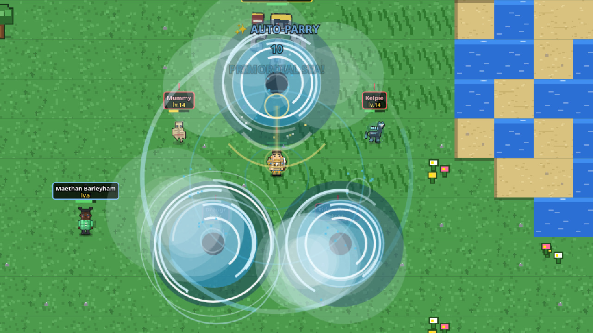
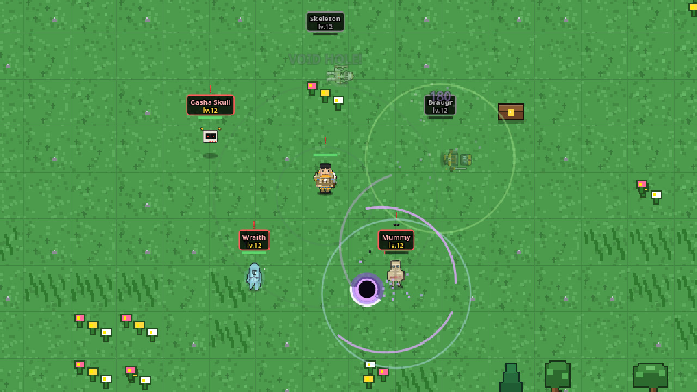
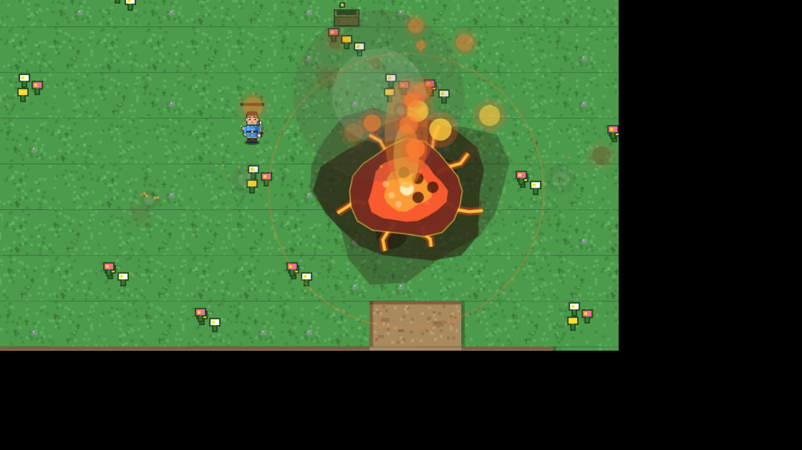
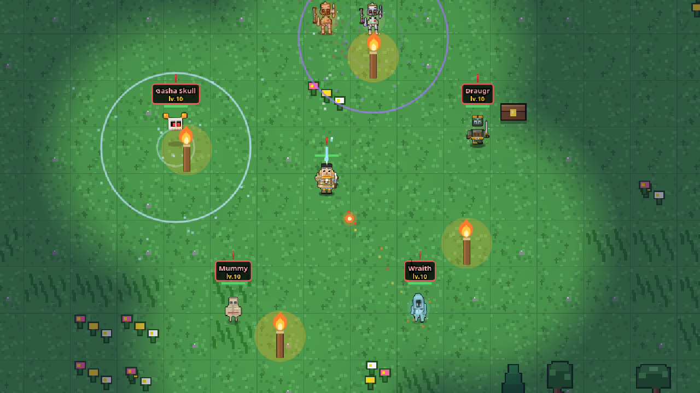
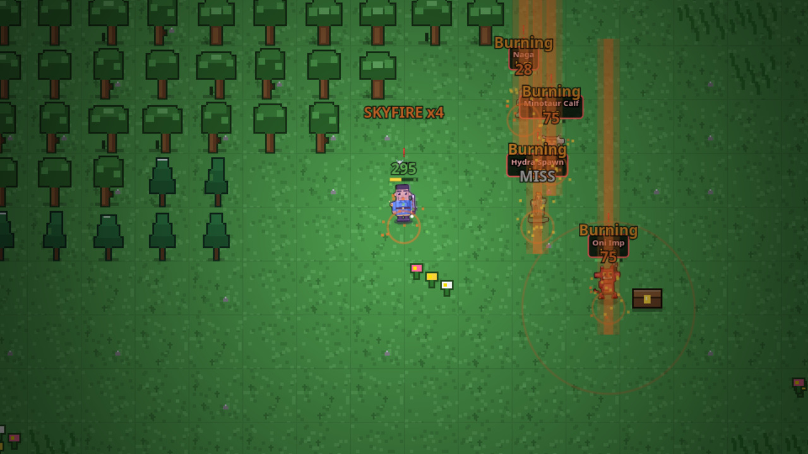
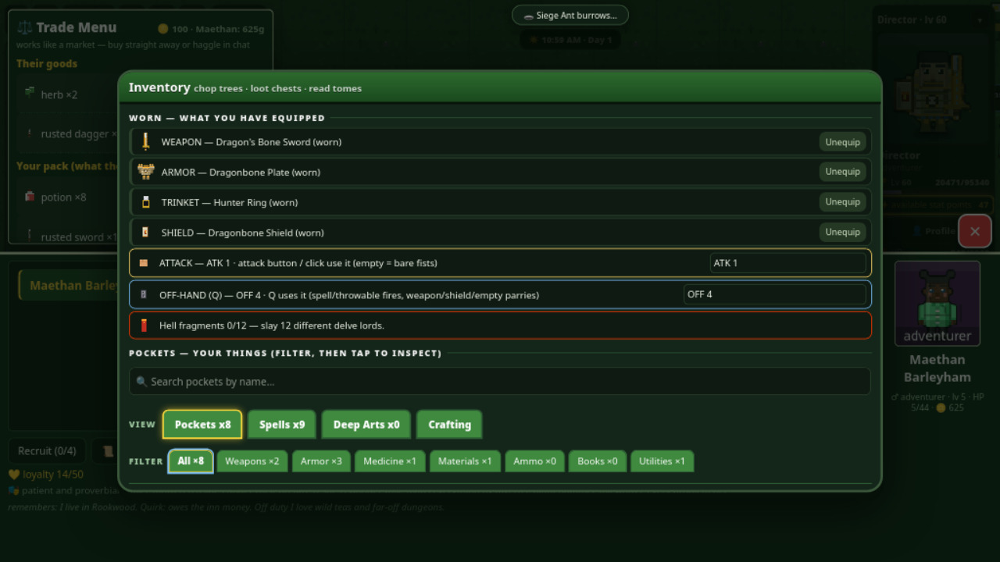
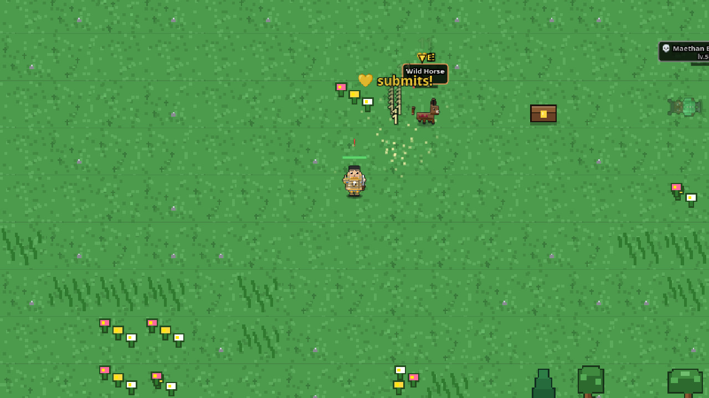
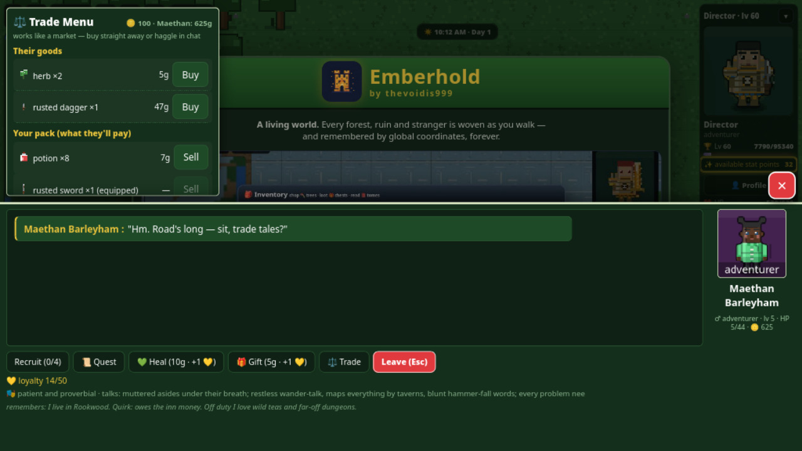

# Emberhold — Living World Dungeon Crawler

A procedurally generated 2D action RPG with a persistent, living world. Explore towns, wilds, delves and lairs — every chunk of ground you walk through is stored, so the towns, forests, lakes and dungeons you found are still there tomorrow. Chat with NPCs who remember you, recruit a party of four, level up your stats, and hunt mobs and bosses that roam the world, down into ancient delves and a fallen god.

Built by **thevoidis999** — [GitHub repository](https://github.com/Devanand-PA/emberhold).

## Screenshots

| | |
| --- | --- |
|  |  |
|  |  |
|  |  |
|  |  |

## How it plays

- **WASD / arrows** — move (mobile: left joystick)
- **Mouse** — face; **click or attack** — swing your default weapon
- **1–9 + Space** — hotbar (spells + bound items)
- **Q** — use your off-hand slot; **E** — talk, loot, enter a dungeon
- **R** — ride / dismount a tamed beast
- **M / minimap click** — world map (drag pan, wheel zoom)
- **P / I / C / V** — party, inventory, character, full profile
- **J** — quests; **💾 / Esc** — save and pause

## Game features

- **A living world.** Every 16×16 chunk of ground has persistent global coordinates and is stored, so the world still stands when you come back. The world director (`src/world/ai_director.js`) weaves new places, names, lore and villagers programmatically as you explore.
- **Settlements everywhere.** Thirteen settlement types — villages, towns, walled cities with avenues and gates, canal towns (watergates with moats), sakura towns with planted trees, dwarven fortresses with lava moats, desert souks with oases, steppe ger camps, mesa pueblos, frost holds, trade cities, port cities with harbors, and the double-walled capital — plus townsfolk of every culture.
- **NPCs with persona and memory.** Chat with them through the external Prexzy AI service, with a persona-flavored offline fallback; every NPC remembers you — party members, strangers and townsfolk with work schedules.
- **Mobs and bosses.** Slimes, goblins, skeletons, wyverns and beetles out in the wilds, plus a 50-strong mythic bestiary (minotaurs, harpies, kappa, redcaps, draugr, mummies, nagas...) and human bandits stalking the far wilds. You, NPCs and mobs all have HP/MP/ATK/DEF/SPD, XP, levels and abilities (fireball, heal, whirlwind, water_jet, smite, tideburst...). Weapon-based melee for everyone — daggers are fast/short, spears reach far, whips sweep long distances and stun, silver and dawnstone cut the undead and demons.
- **Delves and horror realms.** Five rule-driven dungeon layouts (crypt, cavern, maze, hall, sunked lake) with per-floor themes, 12–15 floors deep, and a fallen god at the end. Plus a separate hell dimension (the Supreme Overlord's Castle at hell's heart, its own four holding realms) and a heaven dimension once the goddess of Dawn reaches you.
- **Quests.** Villager work offers, guild contracts, and the built-in main campaign (the Hearthkeeper speaks, a oath is sworn, the goddess sends you after the first delve, the fragments, the sphere, the towers, Hell, the Dark Castle, and the 5-level god-delve — with three endings).
- **Loot and character.** Weapons, armor, shields, bows with real arrows, wands, staves, rings — all forged and enchantable; status effects (poison, burn, freeze, paralyze, blindness) with curative herbs and cures; taming beasts (party + stable); and inns that retire and retrieve your party worldwide.
- **Atmosphere.** Six color themes, 56 lore sagas × 4 volumes across six shifting manners of speech, and multiplayer channels — host-based, no server, trade/give, mutual heals and a presence list.

## Deep docs

- `src/README.md` — overview and module map (all screens, systems, persistence).
- `src/SPEC.md` — world and mechanics spec (coordinates, biomes, standings, delves, markets...).

## Repo

- GitHub: [Devanand-PA/emberhold](https://github.com/Devanand-PA/emberhold)
